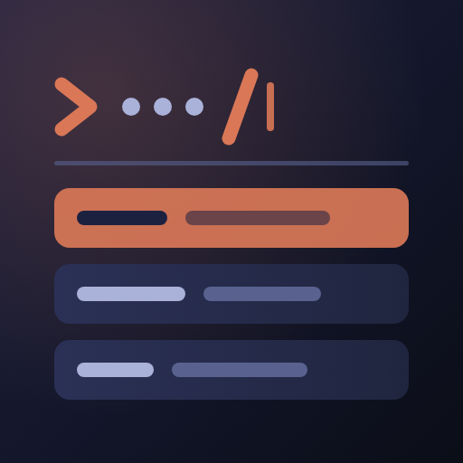
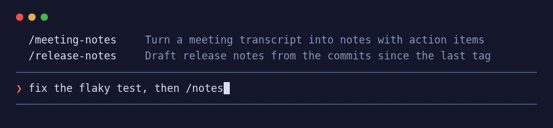

<p align="center">
  
</p>

<h1 align="center">my-skills-anywhere</h1>

<p align="center">A Claude Code mod that opens the menu of your own skills when you type <code>/</code> in the middle of a message.</p>

<p align="center">
  <a href="LICENSE"></a>
  <a href="https://code.claude.com/docs/en/plugins"></a>
  <a href="https://github.com/anthropics/claude-code/issues/95268"></a>
</p>



## The problem

In the Claude Code terminal, the menu of slash commands and skills opens only when `/` is the first character of the input. Type `/` after other text, such as `fix the tests, then /com`, and no menu opens. You must remember the exact skill name, or type the skill first and then go back to write the rest of the message.

A skill that you type in the middle of a message still runs: Claude Code passes it to the model as a skill mention. Only the menu is missing. This mod adds that menu.

### Upstream status

| Date       | Event                                                                                                                                       |
| ---------- | ------------------------------------------------------------------------------------------------------------------------------------------- |
| 2025-12-04 | First report: [#13073](https://github.com/anthropics/claude-code/issues/13073)                                                             |
| Since then | Reported at least 10 times. A bot closed each terminal report as a duplicate or for inactivity. No report got a maintainer response.        |
| 2026-09-18 | [#95268](https://github.com/anthropics/claude-code/issues/95268) opened for the terminal. It is open.                                       |
| 2026-10-01 | The Desktop app report [#89771](https://github.com/anthropics/claude-code/issues/89771) was closed as completed.                            |
| 2026-10-29 | The bug is still present in the terminal in Claude Code 2.1.312, about 11 months after the first report.                                    |

The reports: [#13073](https://github.com/anthropics/claude-code/issues/13073), [#17150](https://github.com/anthropics/claude-code/issues/17150), [#20047](https://github.com/anthropics/claude-code/issues/20047), [#25477](https://github.com/anthropics/claude-code/issues/25477), [#26975](https://github.com/anthropics/claude-code/issues/26975), [#29752](https://github.com/anthropics/claude-code/issues/29752), [#35589](https://github.com/anthropics/claude-code/issues/35589), [#44447](https://github.com/anthropics/claude-code/issues/44447), [#55173](https://github.com/anthropics/claude-code/issues/55173), [#89771](https://github.com/anthropics/claude-code/issues/89771).

If you want a fix in Claude Code itself, add a 👍 to [#95268](https://github.com/anthropics/claude-code/issues/95268).

## Features

- **Menu in the middle of a message.** Type `/` after any other text and your skills show in a menu above the prompt.
- **Loose matching.** The letters you type must appear in the name in the same order. Other letters can come between them. A name that starts with the text ranks first. Letters at the start of a name part (after `-`, `_`, `:`, `/`, `.` or a space) and letters in a run rank higher. So `/hellowo` finds `my-hello-world`, and `/notes` finds `release-notes` and `meeting-notes`. A description that holds the text matches too, after all name matches. The menu shows at most 8 rows.
- **Tab replaces only the token.** Tab puts the first row in place of the `/…` word you typed. The text around it stays.
- **Your own skills only.** The menu lists skills and commands from `~/.claude/skills`, `~/.claude/commands` and the project's `.claude/skills`. Built-in commands such as `/compact` do nothing in the middle of a message, so the menu leaves them out.
- **Skills with `disable-model-invocation: true` are listed too.** They run when you type them yourself, but not when you paste them.
- **No duplicate rows.** At the start of the input, the native menu already lists your skills, so the mod adds nothing there.
- **Survives Claude Code updates.** The mod uses the public mod API (the `prompt.autocomplete` hook and `$.command.list()`). It does not patch the Claude Code binary.

## Limits

- Skills from plugins are not listed in 0.1.0. The mod API cannot tell a plugin skill from a plugin command, and a plugin command does nothing in the middle of a message.
- The rows show without a highlight marker, but Tab takes the first row.
- Tested in the terminal only.

## Requirements

- Claude Code 2.1.312 or later (tested on 2.1.312).

## Install

In one step:

```sh
claude plugin install my-skills-anywhere --marketplace joboyx/my-skills-anywhere
```

Or in two steps, inside Claude Code:

```text
/plugin marketplace add joboyx/my-skills-anywhere
/plugin install my-skills-anywhere@my-skills-anywhere
```

From a local clone, for one session:

```sh
claude --plugin-dir path/to/my-skills-anywhere
```

For a whole team, commit this to the repo's `.claude/settings.json`. Everyone who opens the repo and trusts the folder gets the menu, with no install step:

```json
{
  "extraKnownMarketplaces": {
    "my-skills-anywhere": { "source": { "source": "github", "repo": "joboyx/my-skills-anywhere" } }
  },
  "enabledPlugins": { "my-skills-anywhere@my-skills-anywhere": true }
}
```

Third-party marketplaces do not auto-update by default. Turn it on in `/plugin` → Marketplaces, or run `claude plugin update my-skills-anywhere@my-skills-anywhere`.

## Usage

There is nothing to configure. Type a message, then `/` and part of a skill name:

```text
❯ fix the flaky test, then /notes
```

Press Tab to take the first row, or keep typing to narrow the menu.

## Develop and test

| Task                         | Command                                  |
| ---------------------------- | ---------------------------------------- |
| Unit tests                   | `claude plugin test .`                   |
| Manifest and layout check    | `claude plugin validate . --strict`      |
| Load this copy for a session | `claude --plugin-dir .`                  |

See [AGENTS.md](AGENTS.md) for the layout and the release steps.

## License

MIT. See [LICENSE](LICENSE).
